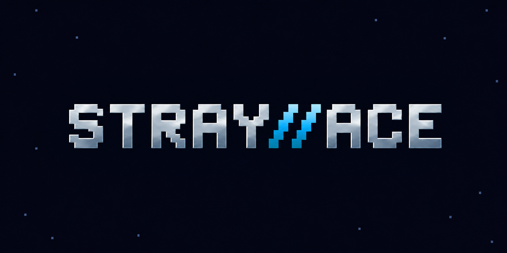

# STRAY//ACE 프로토타입 v0.74

바로 플레이: https://magcargo9999.github.io/stray-ace/

내려받아서 할 때는 `index.html`을 브라우저로 열면 바로 실행된다 (서버 필요 없음). 진행은 브라우저에 자동 저장된다.

## 조작
- WASD 이동 · 마우스 조준(포탑만 회전) · 좌클릭 주무기 · 서브웨폰은 자동 사격
- Q / E 액티브 부품 · Space 파일럿 기술
- Tab 화물칸 (시간 30%, 이동 가능) · 끄는 중 R 회전 · F 싼 것 버리고 줍기 · Esc 일시정지

## 폴더
- `js/data.js` 모든 수치 (기체·파일럿·부품·아이템·적·침식·맵 배율 `MAP_SCALE`)
- `js/story.js` 의뢰·블랙박스·대사
- `js/combat.js` 조작·무기·적 AI·탄막·그레이즈 / `js/raid.js` 맵 생성·POI·줍기·침식·탈출·정산
- `js/render.js` 그리기·HUD / `js/inventory.js` 격자 UI·Tab 창 / `js/hangar.js` 격납고
- `js/audio.js` 효과음·배경음악 (Web Audio 합성, 파일 없음)
- `assets/` 기체 도트 (받은 그대로, 색 변경 없음)

## 1단계에 들어간 것
기체 4종 · 파일럿 5명 · 적 4종 + 네임드 레이븐 + 심연의 사냥꾼 · 폐광 소행성대 1맵 ·
격자 화물칸·보안 칸 · 침식 4단계 · 탈출점 · 난파선·보급 컨테이너·포대 기지·조난 신호 · 격납고(창고·작업대·상점·의뢰·기록)
